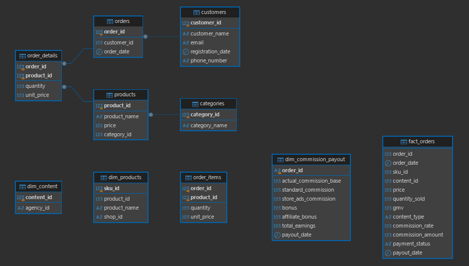

# TikTok Affiliate E-Commerce Data Pipeline & Analytics

## Business Overview
This project delivers an end-to-end relational data pipeline based on a optimized **Star Schema** architecture and performs advanced business analytics for a TikTok Affiliate e-commerce ecosystem (March 1–31, 2026). The analysis evaluates Gross Merchandise Value (GMV) revenue velocity, content channel efficiency (*LIVE Streams*, *Short Videos*, *Link Sharing*, and *Showcase*), anchor product SKU performance, and affiliate commission payout structures.

---

## Key Performance Indicators (March 1–31, 2026)
- **Total GMV:** IDR 2,075,084,455 (~IDR 2.08 Billion)
- **Total Completed Orders:** 6,308 distinct transactions
- **Average Order Value (AOV):** IDR 328,961
- **Total Footwear Units Sold:** 6,957 units

---

## Data Architecture & Relational Schema (ERD)
Unstructured raw e-commerce transaction logs were cleaned, deduplicated, and normalized into a **3-Table Star Schema** in PostgreSQL. This architecture eliminates data redundancy and optimizes SQL analytical join performance.



### **Relational Table Architecture:**
- **`fact_orders`**: Central fact table storing transactional records, completed order IDs, sales volume, GMV, and commission fees.
- **`dim_products`**: Dimension table containing product catalog details, SKU IDs, product names, and pricing structures.
- **`dim_content`**: Dimension table classifying content promotional channels (`LIVE`, `Video`, `Berbagi tautan`, and `Showcase`).

---

## Data Pipeline Integrity & Validation Test
To verify **100% data integrity** and ensure zero record loss or double-counting after table normalization, a validation re-join query was executed across all relational tables:

```sql
SELECT 
    COUNT(DISTINCT f.order_id) AS total_orders,
    SUM(f.gmv) AS total_gmv,
    SUM(f.quantity_sold) AS total_units_sold,
    AVG(f.gmv) AS aov
FROM fact_orders f
JOIN dim_products p ON f.sku_id = p.sku_id
JOIN dim_content c ON f.content_id = c.content_id;
```
Key Business Insights
1. Daily Sales Velocity & Campaign Spikes
Analysis of daily order trends reveals pronounced revenue velocity aligned with campaign periods. Sales peaked on March 25 (IDR 346.7M) and March 18 (IDR 273.4M), driven by payday promotions and concentrated LIVE broadcast schedules. Non-campaign periods maintained a steady baseline average of ~IDR 50M/day (7-day moving average).

2. Content Channel Revenue Share
- LIVE Streaming Dominance: Serves as the undisputed primary revenue driver, generating 84.56% of total GMV (IDR 1.75 Billion) across 5,308 orders.
- Asynchronous Channels: Short Videos contributed 5.75% (IDR 119.4M), Link Sharing generated 5.60% (IDR 116.1M), and Showcase accounted for 4.09% (IDR 85.0M). Separating Link Sharing from Showcase isolates distinct buyer conversion pathways.

3. Anchor Product SKUs (Top 5 Best-Sellers)
- Sales are strongly concentrated in low-top footwear models:
- Sepatu Retrograde Low Black White: Generated the highest revenue at IDR 280.9 Million (1,060 units sold).
- Sepatu Gazelle Low Black White: Followed closely at IDR 245.7 Million (1,213 units sold).
- Risk Factor: Together, these top two anchor SKUs account for over 25% of total store GMV. Stockouts directly endanger LIVE stream conversion rates.

4. Commission Efficiency Analysis
- Evaluating the commission-to-GMV payout ratio highlights channel efficiency:
- Link Sharing (5.31% Ratio): Highest incentive rate, effectively mobilizing external affiliate traffic.
- LIVE Streaming (3.25% Ratio): Highly cost-effective payout structure relative to its massive gross sales output.
- Short Video (3.48%) & Showcase (3.19%): Provide steady, low-overhead passive volume.

Strategic Action Plan
- Scale LIVE Broadcast Slots: Increase live stream frequency during peak evening traffic hours and payday campaign weekends.
- Protect Hero SKU Inventory: Maintain priority safety stock reserves for Retrograde Low and Gazelle Low prior to major live broadcasts.
- Short Video Creator Incentives: Implement tiered performance bonuses for video creators to establish a continuous passive sales baseline alongside LIVE stream spikes.

Tech Stack & Methodology
- Python (Pandas, NumPy): Data Cleaning, Datetime Parsing, Deduplication, & Star Schema Normalization.
- PostgreSQL & DBeaver: Relational Warehouse Design, DDL Schema Definition, & Foreign Key Mapping.
- Advanced SQL: Aggregations, CTEs, Window Functions (7-Day Moving Average), & Multi-Table Joins.
- Tableau Public: Interactive Business Dashboarding, KPI Cards, & Visual Analytics.
- Version Control & Docs: Git, GitHub Markdown, and ERD Visualization.
